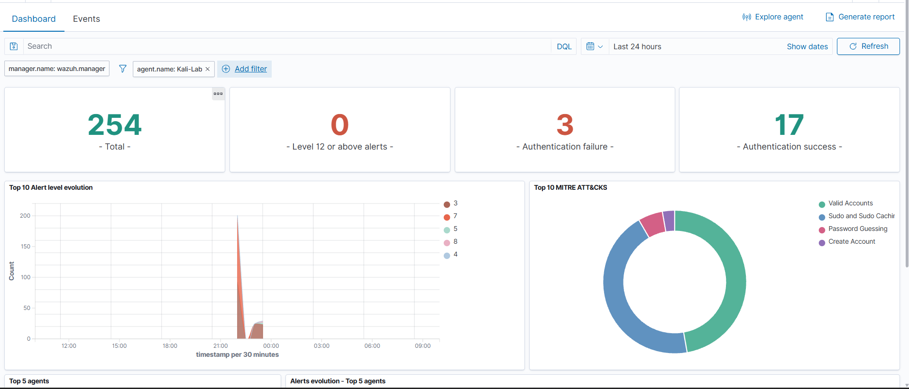
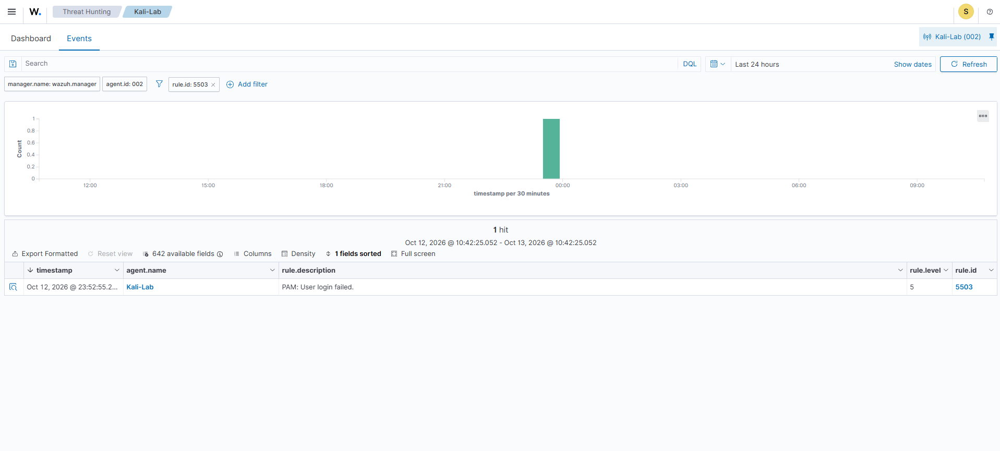
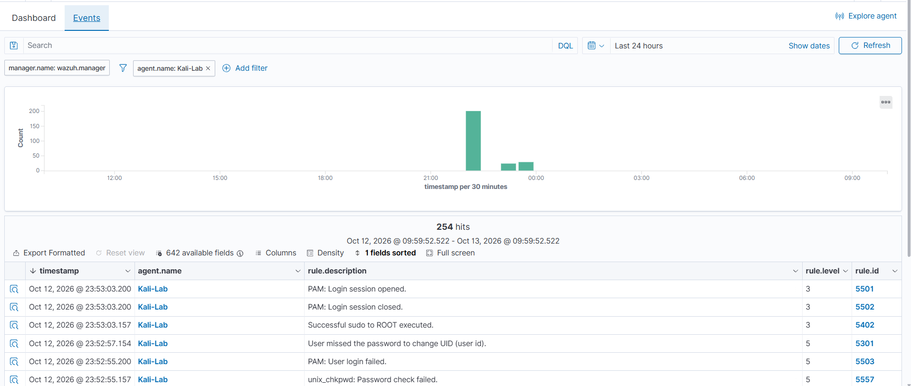
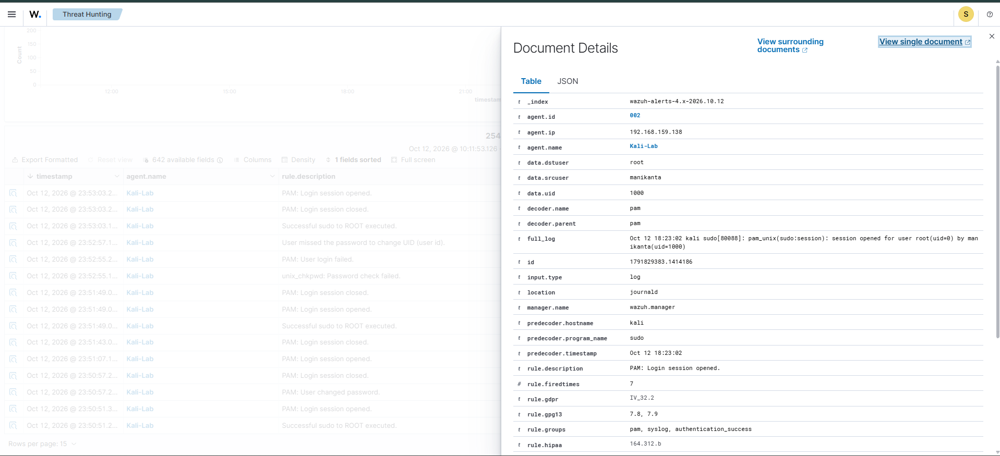
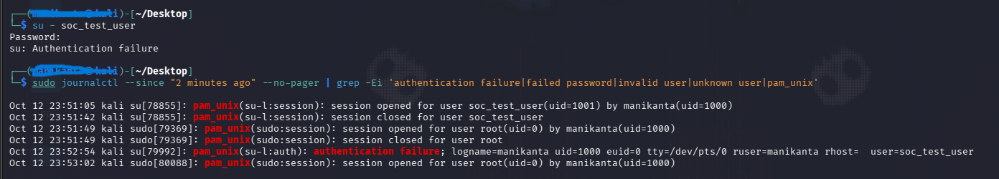
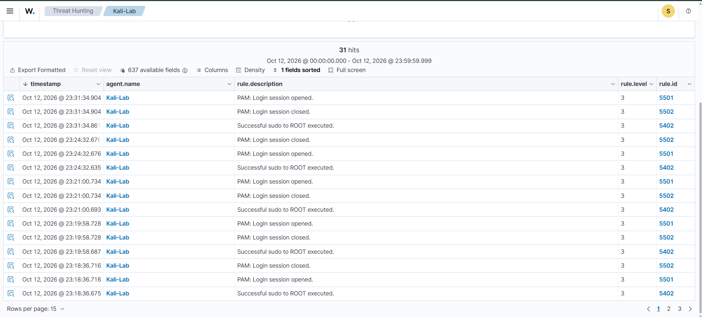

# Wazuh-Home-SOC-Lab


A hands-on Security Operations Center (SOC) lab built using **Wazuh SIEM**, Docker Compose, Ubuntu, and Kali Linux. This project demonstrates endpoint monitoring, Linux authentication-event detection, alert investigation, and basic threat hunting in a controlled virtual environment.

## Project Overview

The goal of this project is to build a beginner-friendly Home SOC environment and understand how a security analyst monitors endpoint activity, investigates alerts, and identifies potentially suspicious authentication behavior.

Wazuh is deployed on an Ubuntu virtual machine, while a Kali Linux endpoint forwards security events to the Wazuh manager for analysis.

## Objectives

- Deploy Wazuh using Docker Compose.
- Connect a Linux endpoint to the Wazuh manager.
- Monitor Linux authentication activity.
- Generate controlled successful and failed authentication events.
- Investigate Wazuh alerts, rule IDs, and severity levels.
- Understand how authentication detections relate to MITRE ATT&CK.
- Practice the basic SOC investigation workflow.

## Lab Environment

| Component | Details |
|---|---|
| Host operating system | Windows 11 |
| Virtualization | VMware |
| SIEM platform | Wazuh 4.14.2 |
| Deployment | Docker Compose |
| Wazuh server | Ubuntu Desktop VM |
| Monitored endpoint | Kali Linux VM |
| Log sources | Linux journal, PAM authentication events |
| Investigation interface | Wazuh Dashboard |
| Additional monitored endpoint | Windows 11 endpoint |
| Windows log source | Windows Security Event Log |

## Lab Architecture

```text
Windows 11 Host
       |
     VMware
       |
       +-----------------------------+
       |                             |
Ubuntu Desktop VM              Kali Linux VM
Wazuh Server                   Wazuh Agent
       |                             |
       |                       Linux Authentication
       |                             Events
       |
       +-----------------------------+
       |
Windows 11 Endpoint
Wazuh Agent
       |
Windows Security Events
       |
       +---------- Event Data --------+
                     |
               Wazuh Manager
                     |
               Detection Rules
                     |
                Security Alerts
                     |
               Wazuh Dashboard
                     |
               SOC Investigation
```

## Screenshots and Evidence

### 1. Wazuh Security Overview Dashboard

The dashboard provides an overview of the security events and alerts available in the lab.



### 2. Authentication Analytics

Authentication-related events from the monitored endpoint can be explored to understand login activity.



### 3. Agent Events and Rule Filtering

Filtering events by rule ID helps narrow down the investigation to relevant authentication detections.



### 4. Expanded Event Details

Inspecting an individual event provides additional information for understanding why an alert was generated.



### 5. Controlled Failed-Login Test

A controlled authentication test was performed on the Kali Linux endpoint using the test account `soc_test_user`. An intentionally incorrect password was entered to generate a failed authentication event.



### 6. Failed-Login Alert Investigation

The corresponding Wazuh alert was investigated to verify that the authentication event was detected by the monitoring system.



## Detection Results

The following authentication-related detections were observed during lab testing.

| Rule ID | Detection | Level |
|---|---|---|
| 5503 | PAM: User login failed | 5 |
| 5557 | unix_chkpwd: Password check failed | 5 |
| 5301 | User missed the password to change UID | 5 |

**MITRE ATT&CK reference:** T1110.001 — Password Guessing, where applicable to the detected authentication behavior.

These events were generated during controlled lab activity. They demonstrate detection and investigation capabilities, not evidence of an actual external attack.

## Investigation Workflow

1. Generate a controlled authentication event on the Kali Linux endpoint.
2. Confirm that the endpoint is connected to the Wazuh manager.
3. Open the Wazuh Dashboard and search for the related alert.
4. Review the rule ID, description, severity, and event details.
5. Correlate the alert with the endpoint's authentication activity.
6. Record the findings and explain the result.

## Windows Endpoint Monitoring and Investigation

In addition to Linux authentication monitoring, a Windows endpoint was connected to the Wazuh server to collect and investigate Windows Security events.

### Windows Lab Details

- Endpoint: Windows 11 host
- SIEM: Wazuh 4.14.2
- Log source: Windows Security Event Log
- Investigation interface: Wazuh Dashboard — Threat Hunting

### Windows Failed-Logon Investigation — Event ID 4625

A controlled failed-login test was performed on the Windows endpoint to verify that Windows Security events were collected and searchable in Wazuh.

**Event details:**

| Field | Observed value |
|---|---|
| Event ID | `4625` |
| Event description | An account failed to log on |
| Severity value | `AUDIT_FAILURE` |
| Logon type | `2` — Interactive |
| Wazuh rule description | `Logon Failure - Unknown user or bad password` |
| Status | `0xC000006D` |
| Substatus | `0xC0000380` |

### Investigation Steps

1. Verified that the Windows endpoint was active in Wazuh.
2. Checked the Windows logon auditing configuration.
3. Generated a controlled failed-login event.
4. Confirmed Event ID 4625 in Windows Event Viewer.
5. Located the corresponding event in Wazuh Threat Hunting.
6. Reviewed the event fields and associated detection rule.

### Result and SOC Assessment

The controlled test confirmed that the Windows Security event reached Wazuh and could be investigated through the dashboard.

A single failed logon does not establish malicious activity. The event fields, surrounding activity, and account context must be reviewed before deciding whether escalation is necessary. The substatus and MITRE ATT&CK mapping should also be validated before assigning a precise cause or attack classification.

### Windows Evidence

Add Windows investigation screenshots under `Screenshots/Windows/` as they become available.

### 1. Windows agent status in Wazuh


### 2. Event ID 4625 in Windows Event Viewer
       Wazuh-Home-SOC-Lab\Screenshots\Windows\02-Windows-4625-event-Viewer.png

### 3. Expanded event details(1)
       Wazuh-Home-SOC-Lab\Screenshots\Windows\03-Event-Details.png

### 4. Expanded event details(2)
       Wazuh-Home-SOC-Lab\Screenshots\Windows\04-Event-Details.png

### 5. Expanded event details(3)
       Wazuh-Home-SOC-Lab\Screenshots\Windows\05-Event-Details.png

Suggested evidence:
- Windows agent status in Wazuh
- Event ID 4625 in Windows Event Viewer
- Matching event in Wazuh Threat Hunting
- Expanded event details


## Key Learnings

- Deploying a SIEM platform using Docker Compose.
- Connecting and monitoring a Linux endpoint with a Wazuh agent.
- Understanding Linux PAM authentication events.
- Investigating failed authentication alerts.
- Interpreting Wazuh rule IDs and severity levels.
- Relating relevant detections to MITRE ATT&CK.
- Practicing a basic SOC alert-triage workflow.

## Current Project Scope

The current implementation covers the Wazuh server, Linux authentication-event monitoring through the Kali Linux agent, and Windows Security Event collection and failed-logon investigation. Additional detection use cases and incident-response exercises can be added as the lab develops.

## Tools and Technologies

- Wazuh SIEM
- Docker Compose
- Ubuntu Linux
- Kali Linux
- VMware
- Linux PAM and system journal
- MITRE ATT&CK
- Windows 11
- Windows Security Event Logs

## Disclaimer

This project is intended for educational purposes and authorized lab testing only. Authentication tests were performed in a controlled virtual environment. The detections documented here should not be interpreted as evidence of a real-world compromise.

## Author

Sai Manikanta
Cybersecurity student focused on SOC operations, Blue Team security, SIEM monitoring, threat detection, and incident investigation.
